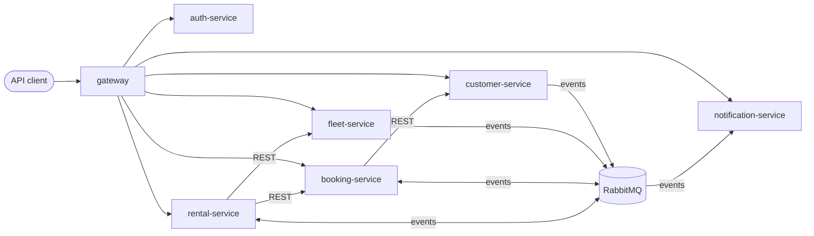

# RentPorto

[](https://github.com/rentporto/rentporto/actions/workflows/ci.yml)

RentPorto is the platform of a car-rental company in Porto, migrated from a modular monolith with a single shared
database to six Spring Boot microservices, one per bounded context or group of contexts. There is no frontend: every
interaction goes through the REST API ([ADR-13](docs/adr/0013-sem-frontend.md)).

> **Status:** the auth, customer, fleet, rental and notification services are implemented. The booking-service
> (reservations, pricing and payments) publishes its complete API contract, but its endpoints still answer
> `501 Not Implemented`.

- [Overview](#overview)
- [Architecture](#architecture)
- [Domain-driven design](#domain-driven-design)
- [Running locally](#running-locally)
- [Developing](#developing)
- [Deploying to Kubernetes (k3d)](#deploying-to-kubernetes-k3d)
- [Documentation](#documentation)

## Overview

The life of a rental:

1. **Quote.** A customer registers, fills in the profile (tax number, driving licence) and asks for a quote for a
   vehicle category, at a station, for a period.
2. **Reservation.** The customer books and prepays. Once the payment succeeds, the reservation is confirmed and its
   contract terms are frozen.
3. **Pick-up.** An agent takes the deposit on the customer's card, and the fleet assigns a vehicle of the reserved
   category.
4. **Return.** The agent records the return inspection (odometer, fuel, damages). The late-return, fuel and damage
   charges are computed and the deposit is settled.
5. **Notifications.** The customer receives an email at each step, including a reminder before the pick-up.

| Role | What it does |
|---|---|
| Customer | Registers, manages the profile, quotes, books and cancels reservations, sees rentals and receipts |
| Agent | Looks up customers, handles the pick-ups of the day, hands over and receives vehicles |
| Fleet manager | Manages vehicle categories and vehicles, sends vehicles to maintenance, transfers them between stations |
| Pricing manager | Manages rate cards, seasons, fees, extras and coverages |
| Administrator | Creates the staff accounts, sees the notification history, looks up customers and payments |

Customers sign up themselves; the administrator creates the staff accounts. The first administrator is created when
the auth-service starts ([ADR-20](docs/adr/0020-chave-dos-jwt-e-primeiro-administrador.md)).

## Architecture



- **Gateway:** the only entry point, at `/api/v1`. It validates the JWT, routes each resource to the service that owns
  it and limits the logins per IP ([ADR-21](docs/adr/0021-entrada-pelo-api-gateway.md)).
- **Data:** each service owns its database: one PostgreSQL instance, with one logical database and one user per
  service ([ADR-05](docs/adr/0005-postgresql-com-uma-base-por-servico.md)).
- **Communication:**
  - REST when the caller needs an immediate answer, messages on RabbitMQ when state changes
    ([ADR-02](docs/adr/0002-comunicacao-hibrida.md), [ADR-03](docs/adr/0003-rabbitmq-como-broker-de-mensagens.md));
  - calls between services carry the user's JWT ([ADR-22](docs/adr/0022-chamadas-entre-servicos-com-o-jwt-do-utilizador.md)).
- **Configuration:** a Spring Cloud Config Server serves the `config/` folder
  ([ADR-19](docs/adr/0019-configuracao-externa-no-config-server.md)).
- **Observability:**
  - metrics in Prometheus and Grafana ([ADR-24](docs/adr/0024-metricas-com-prometheus-e-grafana.md),
    [ADR-26](docs/adr/0026-painel-do-grafana.md));
  - traces in Zipkin ([ADR-25](docs/adr/0025-rastreio-distribuido-com-zipkin.md)).

| Service | Port | Bounded contexts | Status |
|---|---|---|---|
| `gateway` | 8080 | — | Implemented |
| `auth-service` | 8081 | Identity and Access | Implemented |
| `customer-service` | 8082 | Customers | Implemented |
| `fleet-service` | 8083 | Fleet | Implemented |
| `booking-service` | 8084 | Reservations, Pricing, Payments | API contract only |
| `rental-service` | 8085 | Rental | Implemented |
| `notification-service` | 8086 | Notifications | Implemented |
| `config-server` | 8888 | — | Implemented |

**Stack:**

| Area | Technologies |
|---|---|
| Services | Java 25, Spring Boot 4.1, Spring Cloud 2025.1 (Gateway, Config, OpenFeign) |
| Security and resilience | Spring Security with RS256 JWT, Resilience4j |
| Data and messaging | PostgreSQL 17 with JPA and Flyway, RabbitMQ 4.1 |
| API documentation | springdoc OpenAPI, AsyncAPI |
| Observability | Micrometer, Prometheus, Grafana, Zipkin |
| Tests | JUnit, Testcontainers, WireMock, ArchUnit |
| Delivery | Docker, Kubernetes (k3d, Kustomize), GitHub Actions |

## Domain-driven design

### Bounded contexts

A simplified Event Storming found eight bounded contexts. The strongest boundary signal was polysemy: "vehicle" and
"customer" mean different things in the fleet, reservations, rental, pricing and payments. The contexts are grouped
into six services:

- **The booking-service holds three contexts** (Reservations, Pricing, Payments) as separate modules, each with its own
  database schema. Quote, reservation and prepayment happen in the same flow
  ([ADR-01](docs/adr/0001-decomposicao-em-microsservicos.md), [ADR-15](docs/adr/0015-estrutura-modular-do-booking-service.md)).
- **Certified invoicing is out of scope:** it stays in the remaining monolith.

| Context | Owner | Main model | Responsibility |
|---|---|---|---|
| Identity and Access | auth-service | `Account`, `Email`, `Role` | Accounts, login, signing the JWT, publishing the JWKS |
| Customers | customer-service | `Customer`, `TaxNumber`, `DriverLicense`, `DriverProfile` | Customer profile and driver eligibility |
| Fleet | fleet-service | `Vehicle`, `VehicleCategory`, `Station`, `Transfer`, `VehicleAssignment`, `AcrissCode`, `LicensePlate` | Categories, vehicles and their status, station capacity, transfers, assigning a vehicle at pick-up |
| Reservations | booking-service `reservation` | Reservation (planned) | Availability, the reservation saga, expiry and no-shows |
| Pricing | booking-service `pricing` | Rate cards, seasons, fees, extras, coverages | Quotes |
| Payments | booking-service `payment` | Payments, deposits, refunds, receipts | Charging a simulated payment provider ([ADR-29](docs/adr/0029-pagamentos-simulados.md)) |
| Rental | rental-service | `RentalAgreement`, `ContractTerms`, `ReturnInspection`, `Settlement`, `Money` | Pick-up, return inspection, extra charges, settlement |
| Notifications | notification-service | `Notification`, `Recipient`, `PickupReminder` | Customer emails and pick-up reminders |

### Ubiquitous language

| Term | Meaning |
|---|---|
| Category | An ACRISS code (e.g. `CDMR`). Customers reserve a category, not a vehicle; a vehicle of that category is assigned at pick-up ([ADR-10](docs/adr/0010-reservar-por-categoria.md)). |
| Station capacity | How many vehicles of a category a station can deliver. It limits availability. |
| Contract terms | Daily rate, extras, coverage, excess, deposit and fuel prices agreed at booking. They are frozen in the `ReservationConfirmed` event, so a later price change does not affect the rental ([ADR-09](docs/adr/0009-termos-contratuais-no-reservation-confirmed.md)). |
| Deposit | An amount held on the customer's card at pick-up. At return it is settled: the amount due is captured and the rest is released. |
| Return inspection | Odometer, fuel level and damages recorded at return. They drive the extra charges (late return, fuel, damage). |
| Settlement | The final account of a rental. |
| Transfer | Moving a vehicle between stations. |
| No-show | A confirmed reservation whose customer never picked up the vehicle. |

### Integration between contexts

Every message uses the same envelope (`eventId`, `type`, `version`, `occurredAt`, `correlationId`, `payload`).
- **Events** go to the topic exchange `rentporto.events`.
- **Commands** go to their own queue.

The contracts are in [`docs/asyncapi/asyncapi.yaml`](docs/asyncapi/asyncapi.yaml). The queues and their dead-letter
queues are in [`infra/rabbitmq/definitions.json`](infra/rabbitmq/definitions.json).

| Message | Published by | Consumed by |
|---|---|---|
| `CustomerRegistered` | customer | notification |
| `StationCapacityChanged`, `VehicleCategoryChanged` | fleet | booking |
| `ReservationConfirmed`, `ReservationCancelled`, `ReservationNoShow` | booking | rental, notification |
| `ReservationExpired`, `PaymentFailed`, `PaymentRefunded` | booking | notification |
| `DepositSettled` | booking | rental |
| `RentalStarted` | rental | booking, notification |
| `VehicleReturned` | rental | fleet, booking |
| `RentalClosed` | rental | notification |
| `SettleDeposit` (command) | rental | booking |

Synchronous calls:
- **rental → fleet:** assigns a vehicle at pick-up. It has timeouts and retries, which are safe because of the
  `Idempotency-Key`.
- **rental → booking:** takes the deposit at pick-up. A circuit breaker protects it.
- **booking → customer:** reads the driver profile when booking (planned).

### Reservation saga

The `reservation` module orchestrates the booking, and the state of the reservation is the state of the saga
([ADR-06](docs/adr/0006-saga-orquestrada-na-reserva.md), [ADR-29](docs/adr/0029-pagamentos-simulados.md)):

1. In one transaction, it checks the capacity, uses the quote and creates the reservation as `PENDING_PAYMENT`.
2. After the commit, the `payment` module charges the payment provider.
3. If the payment succeeds, the reservation becomes `CONFIRMED` and `ReservationConfirmed` is published. If it fails,
   the reservation becomes `PAYMENT_FAILED` and the capacity is released.
4. A scheduler expires reservations that are not paid within 15 minutes and marks the no-shows.

The reactions are choreographed by events:
- **On confirmation:** the rental-service creates the rental agreement, and the notification-service emails the
  customer.
- **At return:**
  - one transaction records `VehicleReturned` and the `SettleDeposit` command;
  - `DepositSettled` closes the agreement and publishes `RentalClosed`.

### Reliability patterns

- **Transactional outbox:** a message is written in the same transaction as the change and published afterwards
  ([ADR-07](docs/adr/0007-outbox-e-consumidores-idempotentes.md)).
- **Idempotent consumers:** each consumer records the events it has handled, so a message delivered twice is handled
  once.
- **Retries and dead-letter queues:** three attempts with backoff, then the message goes to the queue's `.dlq`.
- **Shared lock in JPA:** a scheduled task runs on one replica only
  ([ADR-18](docs/adr/0018-lock-partilhado-em-jpa.md)).
- **`Idempotency-Key`:** creating a resource twice with the same key returns the same resource.
- **Anti-corruption layers:**
  - each service translates the messages and responses of other services into its own model;
  - the domain never uses the shared message contracts.

### Code structure

Each service follows a hexagonal architecture ([ADR-15](docs/adr/0015-estrutura-modular-do-booking-service.md)):
- **Dependencies point inwards:** `api` and `infrastructure` → `application` → `domain`.
- **The domain does not use Spring.**
- **The application reaches the outside only through its ports.**

Inside each layer there is one folder per kind of file ([ADR-30](docs/adr/0030-organizacao-dos-pacotes.md)):

```
pt/rentporto/{service}/
├── api/             contract · controller · request · response · model
├── application/     service · port · exception · model
├── domain/          model · repository · service · exception
└── infrastructure/  one folder per technology: persistence, messaging, security, client, mail…
```

These rules are not just conventions. The `ArchitectureTest` of every service runs
[`ArchitectureRules`](common-web/src/test/java/pt/rentporto/web/testing/ArchitectureRules.java) (ArchUnit), so a class in
the wrong layer or folder fails the build.

## Running locally

**Prerequisites:**
- JDK 25: with SDKMAN, `sdk env` reads [`.sdkmanrc`](.sdkmanrc);
- Docker with Compose v2;
- Node.js, only for the Bruno CLI.

Always use the Maven wrapper (`./mvnw`).

**1. Start the infrastructure:** PostgreSQL, RabbitMQ, Mailpit, Prometheus, Grafana, Zipkin and WireMock.

```bash
docker compose up -d --wait
./infra/verify.sh
```

The passwords default to the values in [`.env.example`](.env.example). To change them, copy it to `.env`.

**2. Build once**, so that each service finds the shared modules:

```bash
./mvnw -DskipTests clean install
```

**3. Start the Config Server first**, then the services and the gateway, each in its own terminal:

```bash
./mvnw -pl config-server spring-boot:run
./mvnw -pl auth-service spring-boot:run
./mvnw -pl customer-service spring-boot:run
./mvnw -pl fleet-service spring-boot:run
./mvnw -pl booking-service spring-boot:run
./mvnw -pl rental-service spring-boot:run
./mvnw -pl notification-service spring-boot:run
./mvnw -pl gateway spring-boot:run
```

**The `dev` profile** is the default:
- **Configuration:** the Config Server reads the local [`config/`](config) folder, so a change applies when the
  service restarts, without a commit.
- **First administrator:** the auth-service creates it at startup. Its credentials are in
  [`config/auth-service.yml`](config/auth-service.yml) and in the [infrastructure README](infra/README.md).
- **JWT key:** the auth-service generates a new key at each start, so log in again after restarting it.

| What | Where |
|---|---|
| API | http://localhost:8080/api/v1 |
| Swagger UI (all services) | http://localhost:8080/api/docs |
| Mailpit (emails sent) | http://localhost:8025 |
| RabbitMQ console | http://localhost:15672 |
| Prometheus | http://localhost:9090 |
| Grafana dashboard | http://localhost:3000/d/rentporto |
| Zipkin | http://localhost:9411 |

**Try the API** with the [Bruno collection](docs/bruno/README.md). It has one folder per role and logs in by itself:

```bash
cd docs/bruno
npx @usebruno/cli@4.3.0 run --env compose
```

**Payments** are simulated: the test card of the reservation decides the answer (`card_ok`, `card_declined`,
`card_no_extra`, `card_slow`). See [ADR-29](docs/adr/0029-pagamentos-simulados.md) and the
[infrastructure README](infra/README.md).

**Stopping:**
- `docker compose stop` stops the infrastructure and keeps the data.
- `docker compose down -v` also deletes the volumes, and with them **all the local data**.

## Developing

**Build and test** (the integration tests use Testcontainers, so Docker must be running; they do not need the Config
Server):

```bash
./mvnw clean verify                          # every module
./mvnw -pl fleet-service -am clean verify    # one service and the modules it uses
```

**Contracts are tested:**
- **OpenAPI:** `OpenApiContractTest` compares each service's API with its committed contract in
  [`docs/openapi/`](docs/openapi). After an intended change, regenerate the contract with
  `./mvnw -pl <service> -am clean verify -Dopenapi.update=true`, then commit it.
- **AsyncAPI:** the `common-events` tests check [`docs/asyncapi/asyncapi.yaml`](docs/asyncapi/asyncapi.yaml) and the
  RabbitMQ definitions against the message classes.

**Conventions:**
- **Stories and branches:**
  - each user story is an issue `RP-NN`, written with the issue template;
  - work happens on a branch per story, with commits like `feat(RP-54): …` or `refactor: …`;
  - pull requests follow the [template](.github/pull_request_template.md);
  - `main` only accepts pull requests whose `CI result` check passes
    ([ADR-17](docs/adr/0017-repositorio-publico.md)).
- **Architecture decisions:** each one is an ADR in [`docs/adr`](docs/adr/README.md), written in Portuguese. To add
  one, copy `0000-modelo.md` to the next number. An accepted ADR is not edited; a new one replaces it.
- **Shared files:**
  - configuration changes go through pull requests to [`config/`](config);
  - the Grafana dashboard is code: change [`infra/grafana/dashboards/rentporto.json`](infra/grafana/dashboards/rentporto.json),
    not the Grafana UI.
- **Endpoints:**
  - a new public resource needs a route in the gateway;
  - endpoints used only by other services live under `/internal/**`, and the gateway does not expose them.

```
├── auth-service, customer-service, fleet-service,
│   booking-service, rental-service, notification-service
├── gateway            API gateway
├── config-server      Spring Cloud Config Server
├── common-events      message contracts shared by the services
├── common-messaging   outbox, idempotent consumers, scheduler lock
├── common-web         error format, OpenAPI, security, clock; test helpers
├── config             configuration served by the Config Server
├── infra              compose infrastructure, Kubernetes manifests, Prometheus, Grafana, RabbitMQ
├── docs               ADRs, OpenAPI, AsyncAPI, Bruno collection
├── compose.yaml       local infrastructure
└── deploy.sh          deployment to k3d
```

## Deploying to Kubernetes (k3d)

There is no cloud environment. The production-like deployment is a local Kubernetes cluster in k3d, with the same
images, probes, resource limits, secrets and autoscaling a real cluster would use
([ADR-16](docs/adr/0016-k3d-como-cluster-local.md), [ADR-23](docs/adr/0023-disponibilizacao-no-k3d.md)).

**Prerequisites:** Docker with about 10 GB of memory, `k3d`, `kubectl`, `openssl`, `curl` and `python3`.

```bash
./deploy.sh                           # create or start the cluster, build, deploy and check
./deploy.sh --skip-build              # reuse the images already built
CONFIG_LABEL=<branch> ./deploy.sh     # the Config Server reads another branch pushed to GitHub
```

The script:

1. **Cluster:** creates the cluster `rentporto` (or starts it), without switching your `kubectl` context. Use
   `--context k3d-rentporto` in your commands.
2. **Images:** builds the eight applications and imports their images into the cluster.
3. **Secrets:** creates the ones that do not exist yet, with random passwords and a new key to sign the JWT.
4. **Manifests:** applies the `k3d` overlay of [`infra/k8s`](infra/k8s).
5. **Waiting:** waits until every pod is ready.
6. **Checks:**
   - the administrator logs in through the Ingress;
   - the Swagger UI answers;
   - Prometheus scrapes every application and RabbitMQ;
   - the Grafana dashboard works;
   - Zipkin has the trace of the login;
   - the autoscaler measures the CPU.

To reach the system, add these two lines to `/etc/hosts`:

```
127.0.0.1 rentporto.local
::1 rentporto.local
```

- **API:** http://rentporto.local/api/v1.
- **Swagger UI:** http://rentporto.local/api/docs.
- **Administrator password:**
  ```bash
  kubectl --context k3d-rentporto -n rentporto get secret auth-service -o jsonpath='{.data.AUTH_ADMIN_PASSWORD}' | base64 --decode
  ```
- **Tools:** the Ingress only routes `/api`, so open the tools with a port-forward, for example
  `kubectl --context k3d-rentporto -n rentporto port-forward svc/grafana 3000`. The services are `rabbitmq` 15672,
  `mailpit` 8025, `prometheus` 9090, `grafana` 3000 and `zipkin` 9411.
- **Autoscaling:** the booking-service scales between 2 and 3 replicas with its CPU
  ([ADR-28](docs/adr/0028-escala-automatica-do-booking-service.md)). `./infra/k8s/load-booking.sh` puts load on it, so
  you can watch it scale.
- **Removing everything:** `k3d cluster delete rentporto` deletes the cluster, its secrets and its data.

**Continuous integration** ([`ci.yml`](.github/workflows/ci.yml)) runs on every pull request and on every push to
`main`:
- builds and tests the services the change affects;
- on `main`, publishes their images to `ghcr.io/rentporto/<service>`, tagged with the commit;
- checks the message contracts;
- starts the compose infrastructure;
- validates the Kubernetes manifests.

## Documentation

| Document | Content |
|---|---|
| [`docs/adr`](docs/adr/README.md) | Architecture decision records (in Portuguese) |
| [`docs/openapi`](docs/openapi) | OpenAPI contract of each service, also browsable in the Swagger UI |
| [`docs/asyncapi/asyncapi.yaml`](docs/asyncapi/asyncapi.yaml) | Contract of the messages |
| [`docs/bruno`](docs/bruno/README.md) | Bruno collection, one folder per role |
| [`infra/README.md`](infra/README.md) | Local infrastructure and the k3d cluster in detail (in Portuguese) |

## Team

Nuno Soares and Vitor Sousa.
